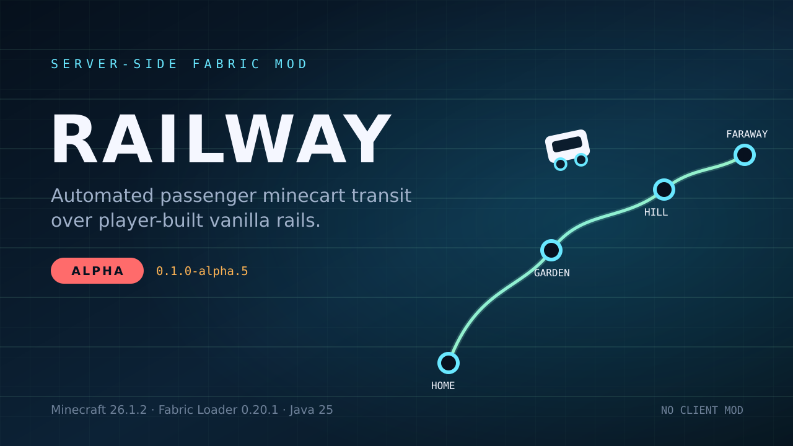

# Railway



Railway is a server-side Fabric mod for automated passenger minecart travel over
player-built vanilla rails. A passenger presses a registered stone button; Railway
spawns a service cart, seats the passenger, routes it over the scanned rail graph,
stops at the destination dock, and places the passenger at the station exit.

Ordinary clients do not need the mod. The server owns stations, bindings, service
carts, routing, reservations, recovery, and diagnostics.

- Minecraft: **26.1.2**
- Fabric Loader: **0.20.1+**
- Fabric API: **0.155.3+26.1.2**
- Java: **25+**
- License: **MIT**

Current version: `0.1.0-alpha.5`. This is an alpha build. Test on a backup
world before using it on a world you care about.

## Status

Implemented and tested through Stage 5 operations:

- station and button commands;
- straight-line and graph routing, curves, slopes, and turnouts;
- managed-cart speed control and atomic route reservations;
- construction from vanilla wall signs and stone buttons;
- chained station pillars, local departure docks, and optional main-arrival flag;
- bounded local chunk tickets and readiness gates;
- crash-recovery checkpoints and late-chunk reconciliation;
- `/rail diagnostics`.

See [`docs/stage-5-report.md`](docs/stage-5-report.md) for the current verification
summary and remaining limitations.

## Install

1. Create or use a Fabric **server** with the versions above.
2. Put `railway-0.1.0-alpha.5.jar` and the matching Fabric API in the server
   `mods/` directory.
3. Start the server once. Railway creates `config/railway.json`.
4. Adjust the config if needed, then `/rail reload` or restart.
5. Give builders OP level 2, or list their UUIDs in `builders`.

No client mod or resource pack is required. The default messages are English and
Russian; they are sent as plain server text.

To build from source:

```bash
./gradlew build
# server jar: build/libs/railway-0.1.0-alpha.5.jar
```

Alpha release pipeline and Modrinth setup: [`docs/release.md`](docs/release.md).
Remaining production gates: [`TODO.md`](TODO.md).

## Quick start: a three-pillar station

A station has a **main arrival pillar** and any number of destination pillars.
Each destination unit is one solid pillar with one **wall sign** and one **stone
button**. Signs use three or four lines:

```text
[Railway]
Home
Garden
m
```

- line 1: exact `[Railway]` marker
- line 2: source station name
- line 3: destination station name
- line 4: optional `m` flag; marks this pillar as the station main arrival point

`m` may be omitted. The first/anchor pillar is main by default.

Example layout:

```text
Home station
├── central main-only pillar:  [Railway] Home (blank line 3) m   no button
├── Home/Garden pillar:        [Railway] Home / Garden            stone button
└── Home/Mine pillar:          [Railway] Home / Mine              stone button

Garden: [Railway] Garden / Home + stone button
Mine:   [Railway] Mine / Home   + stone button
```

Rules:

- Use a **wall sign**, not a standing or hanging sign.
- Use one **stone button** on the same solid pillar column as a destination sign.
- The sign and button can be at independent heights, one to three blocks above
  the rail support (`dockY` through `dockY + 2`).
- The pillar must be one to three horizontal blocks from the local rail.
- The sign's normal axis must point across the track. Railway scans both sides of
  the sign for exactly one straight horizontal dock rail.
- One pillar carries one sign and one button. Multiple destinations use multiple
  pillars.
- A destination unit must be within four horizontal blocks of an existing pillar
  of the same station. This is a chain rule, not a distance-to-main rule. The
  station is capped at 16 sign units and 64 blocks from main.
- A new destination unit whose rail is not on the station's scanned rail component
  is rejected.
- Save the sign after placing the button. If you add/remove the button later,
  save the sign again.

Departure is always from the pressed pillar's local dock. Arrival is always at the
station's main dock/exit. To move main, put `m` on another pillar and save it.

## Passenger flow

1. Stand at a destination pillar and press its stone button.
2. Railway checks permission, station state, route, reservations, and the ticket
   window.
3. A service cart spawns at the local dock; the passenger is seated automatically.
4. The cart follows the graph route through turnouts and curves.
5. It stops at the destination main dock and teleports the passenger to the
   station exit with the stored yaw.
6. The service cart is removed. Active trips are not resumed after a server
   restart; recovery reconciles them safely.

There is no ticket, queue, GUI, or manual trip command for passengers.

## Commands

All station changes are OP level 2 by default. Passengers only need to use a
registered button.

```text
/rail station create <id> <displayName...>
/rail station exit <id>
/rail station rename <id> <displayName...>
/rail station enable|disable <id>
/rail station info <id>
/rail station list
/rail station remove <id>
/rail button bind|info|unbind
/rail network scan <station>
/rail network status [station]
/rail route check <from> <to>
/rail trip list
/rail trip abort <tripId>
/rail diagnostics [station]
/rail reload
```

Service signs are the normal construction path. The command path remains available
for administration and migration. See [`docs/commands.md`](docs/commands.md).

Graph scans start automatically: after a server restart anchored stations in
loaded dimensions are scanned one at a time, and each successful scan covers
every station on its connected component, so startup performs one scan per
component instead of one per station. A trip launch or `/rail route check`
starts a missing scan on demand. `/rail network scan` is only a manual forced
rescan/diagnostic tool and is never required before a trip.

## Configuration

Config lives at `config/railway.json`. Important defaults:

| Key | Default | Purpose |
|---|---:|---|
| `maxActiveTrips` | 8 | Concurrent trips |
| `maxSpeed` | 12.0 | Target blocks/second, capped at 12 |
| `boardingRadius` | 4 | Command/legacy boarding radius |
| `maxManagedChunkTickets` | 128 | Local ticket budget; 0 disables tickets |
| `maxRouteLength` | 10000 | Maximum graph route length |
| `builders` | `[]` | UUIDs allowed to register signs in addition to OP2 |

Invalid configuration is not overwritten: Railway disables itself until the file
is fixed and `/rail reload` or a restart succeeds. See
[`docs/configuration.md`](docs/configuration.md) for every key and range.

## Operations

- `/rail diagnostics` prints live trips, recovery, scans, reservations,
  quarantines, chunk tickets, and station units/main.
- Chunk tickets keep only the current local window and braking window ready; the
  whole route is not force-loaded.
- A scan pauses at unloaded rail chunks and loads only existing saved frontier
  chunks (bounded, shared ticket budget); it never plans from unloaded data. A
  frontier wider than the 32-ticket scan cap is loaded in deterministic bounded
  subsets, so wide or branching components still scan. Only a zero ticket budget,
  a genuinely unloadable frontier, or a shared budget permanently taken by trips
  and other scans fails with `CHUNKS_NOT_READY`, never a partial graph.
- Scans are derived caches: they auto-start after restart and on demand, so no
  manual `/rail network scan` is needed. Startup scans run one at a time and
  share their graph with every station on the same component; a failed automatic
  scan is retried no more than once per 10 seconds per station, and a successful
  scan clears the delay.
- On restart, persisted checkpoint carts are reconciled by UUID and safely
  removed/stopped; trips never resume automatically.
- State is stored in `<world>/railway/state.json` (schema 4). Migrations create a
  rolling `state.vN.bak` first.

See [`docs/operations.md`](docs/operations.md).

## Important limitations

- A chunk ticket uses vanilla loading/simulation propagation. Railway does not
  request new chunks: trip tickets cover only scanned route chunks and scan
  tickets only chunks that already exist in level storage. Vanilla may still load
  or generate an adjacent missing chunk at the propagation boundary.
- No true long-route-beyond-simulation-distance or mid-trip `kill -9` acceptance
  run has been completed with a real client. The code paths and local tests exist;
  see the Stage 5 report.
- Arrival is station-main only. Per-origin arrival platforms are not implemented.
- A destination unit has one route. To offer several routes from one station,
  build several destination pillars and walk between them.
- Service signs require wall signs, stone buttons, and straight horizontal dock
  rails. Detector and activator rails are rejected by managed routes.
- Ordinary decorative signs are ignored. Railway does not remove player builds.
- No tickets, queues, cargo, schedules, portals, custom rails, or client GUI.
- No guarantee of protection from grief or other movement mods. The production
  stack tested C2ME, Lithium, Krypton, FerriteCore, and Clumps; other combinations
  must be verified.

## Documentation

- [Service signs](docs/service-signs.md)
- [Commands](docs/commands.md)
- [Configuration](docs/configuration.md)
- [Operations and recovery](docs/operations.md)
- [Development and testing](docs/development.md)
- [Release pipeline and Modrinth](docs/release.md)
- [Extended Modrinth description](docs/modrinth-description.md)
- [Acceptance fixtures](docs/fixtures.md)
- [Production TODO](TODO.md)
- [Implementation specification](Railway-Spec-v1.md) (Russian)
- [Stage 4 sign model](docs/stage-4-signs.md)
- [Stage 4.1 chain/local/main model](docs/stage-4-chain-local.md)
- [Stage 5 report](docs/stage-5-report.md)

## License

MIT. Copyright (c) 2026 nikhcevov.
